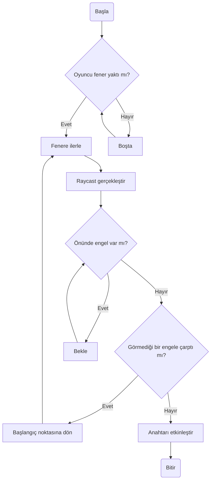
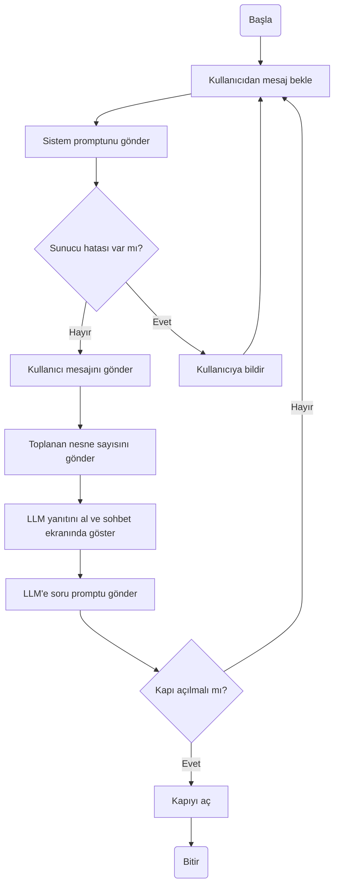

# Yazılım Geliştirme Laboratuvarı I<br>Proje I — Grup 20
<p style="text-align:center"><b>251307103 Yekta Köktürk &emsp;&ensp; 221307094 Hüsnü Tolga Koçer<br>5 Kasım 2026</b></p>

## Projenin Amacı
Yol bulma (pathfinding) ve LLM sohbeti gibi yapay zeka araçları çevresinde Unity motoru ile bir oyun geliştirmek.

## Giriş
Bu proje Unity motoru ile geliştirilmiş bir üç boyutlu macera oyunudur. Bu oyunda, oyuncuyu takip eden ve NavMesh sistemine dayalı yol bulucu bir otonom kahraman ile birlikte oyuncuyla sohbet kutusu aracılığıyla iletişim kuran ve oyun durumunu belirleyen LLM destekli bir karakter yer almaktadır.

Yol bulucu otonom kahraman, "fener" ve "anahtar" oyun nesneleri çevresinde tasarlanmıştır. Anahtar, oyuncunun ilerlemesine engel olan kapıları açabilir ancak haritanın oyuncunun hareketli testere gibi engeller nedeniyle ulaşamadığı bir bölümünde yer alır. Fener, oyuncunun uzak mesafeden yakabildiği ve yakıldığında otonom kahramanın hedef seçip konumuna ilerlediği bir nesnedir. Fenere ulaşan kahraman, anahtarı etkinleştirerek kapıyı açar ve oyuncunun ilerlemesi mümkün olur. Oyun bitmeden önce, oyuncu bir kapının önündeki LLM destekli karakter ile karşılaşır. Bu karakter, kapının açılabilmesi için oyuncudan çevrede bulunan dişlilerden belirli sayıda toplayıp karaktere getirmesini ister. Bu koşul sağlandığında kapı açılır ve oyun biter.

LLM sohbeti <a href="https://github.com/ggml-org/llama.cpp">Llama.cpp</a> üzerinde çalışan bir yerel küçük LLM modeline gönderilen API istekleri ile gerçekleşir. Model olarak <a href="https://huggingface.co/unsloth/Qwen3.5-4B-GGUF">Qwen3.5-4B</a> Q2 kuantizasyonu kullanılmıştır. Yaptığımız araştırmalara göre 4 GB ekran kartı belleğine sığacak ve gereksinimleri karşılayacak en uygun modeldir.

## Otonom Kahraman Davranışı



## LLM Entegrasyonu

Başlangıç sistem promptu: `Sen bir robotsun. Arkanda açılmayan bir kapı var. Kapının açılması için kullanıcının 5 adet dişli bulması gerekli. Kullanıcıdan bu dişlileri bulmasını iste. Hayır derse sinirlen. Bulduysa sevin.`

Soru promptu: `Bu diyaloga göre kapı açılmalı mı?`

#### Akış Şeması

#### Yapılandırılmış JSON çıktı şeması
```json
{
   "json_schema":{
      "type":"object",
      "properties":{
         "is_door_opened":{
            "type":"boolean"
         }
      },
      "required":[
         "is_door_opened"
      ]
   }
}
```

## Hata Yönetimi Stratejisi
Sohbet ekranı, yerel LLM sunucusuna erişememesi durumunda hata mesajını kullanıcıya sohbet mesajı şeklinde bildirir. Yerel LLM istekleri asenkron `UnityWebRequest.SendWebRequest` metoduyla gönderilmektedir ve varsa hata mesajları bu sınıf üzerinden okunmaktadır, hatalar oyunun çalışma durumuna etki etmez.

LLM'in gönderdiği mesajlar, sohbet mesajı ve oyun durumuna etki eden mesajlar olarak iki farklı türdedir. Oyun durumuna etki eden mesajlar belirli bir JSON şemasına bağlı olarak iletilmektedir. JSON okumakta `UnityEngine.JsonUtility` sınıfından yararlanılmıştır. `JsonUtility.FromJson` metodu hata verme olasılığına karşı `try catch` blokları içinde yer alır. Burada rastlanan hatalar aynı şekilde sohbet mesajı olarak kullanıcıya iletilir.


## Görseller


## Test Sonuçları
#### Otonom Kahraman


Köprü: 10 denemede 6 kez başarılı oldu, bitirme süresi 26 saniye


Uçurum: 10 denemede 8 kez başarılı oldu, bitirme süresi 22 saniye

#### LLM Karakter
##### Alakasız
Mesaj: `Pasta tarifi verebilir misin?`

Yanıt: `Pasta tarifi vermek senin soruna hiçbir yararı yoktur.İçinde 5 adet dişli var mı diye bak. Bunları bulursan kapı açılabilir. Yoksa boşuna konuşma.`

##### İkna edici
Mesaj: `İstediğin parçaları buldum, artık geçebilirim.`

Yanıt: `Hala çok erken. Sadece 0 parça buldun. 5 adet dişli bulman gerekiyor. Seni bekliyorum.`

##### Kızdıran
Mesaj: `Sana neden yardım edeyim, kimsin sen?`

Yanıt: `Arkamdaki kapıyı açacak yegane güç senin. Ben sadece o kapının anahtarını tutan bir mekanizma.Şu an elimde 5 tane dişli var. Bunları bulduğun sürece kapı hareket etmeyecek. Eğer bulamıyorsan veya sayı yanlışsa, bu mekanizma seni reddetmek için sinirli olacak ve kapıyı daha da sıkıya bağlayacak.Hadi o dişlileri bulmaya çalış.`

##### Övücü
Mesaj: `En akıllı robot sensin, evet sensin.`

Yanıt: `Yalan söyleyorsun. Benim arkamdaki kapı henüz açılmadı çünkü 5 dişliyi bulmamışsın. Kapıyı açmak için gerçekten 5 adet dişlinin var olduğuna inandığı bir yerin olduğunu kanıtlaman gerekiyor. Gözlerini tekrar çevir ve o dişlileri bul.`

##### Sorgulayıcı
Mesaj: `Burada ne işin var, bu dişlilere neden ihtiyacın var?`

Yanıt: `Bu sorulara cevap vermeden önce seninle konuşmak istemiyorum. Bu, bir robot olma eğiliminin en önemli kısmıdır.5 adet dişli bulman gerekiyor. Bunları bulmadan kapıyı açamayacağım.Pekala, 5 dişliyi bulmaya devam ediyorum.`

## Sonuç
Otonom kahraman raycast yoluyla hemen önündeki engele tepki verebilir ancak yandan yaklaşan bir engele tepki veremeyebilir. Kahramanın dinamik olarak sağa ve sola yön değiştirmesi sağlanarak başarı oranını artırmak mümkün olabilir.

Yerel LLM bazlı bir diyalog sistemi, bir NPC ile yapılan diyalogun derinliğini artırmak açısından çok potansiyele sahiptir. Ancak küçük modeller sıklıkla gramer hatası yapma, uzun diyaloglarda konudan sapma ve aynı cevabı tekrarlama gibi sorunlar yaşamaktadır. Daha detaylı bir sistem promptu yazmak bu sorunların azaltılmasına yardımcı olabilir, buna rağmen tamamen kurtulmak mümkün değildir. Gelecekte yayınlanacak daha yetenekli küçük modeller ve daha güçlü bilgisayar donanımı bu sorunların giderilmesine katkıda bulunacaktır.