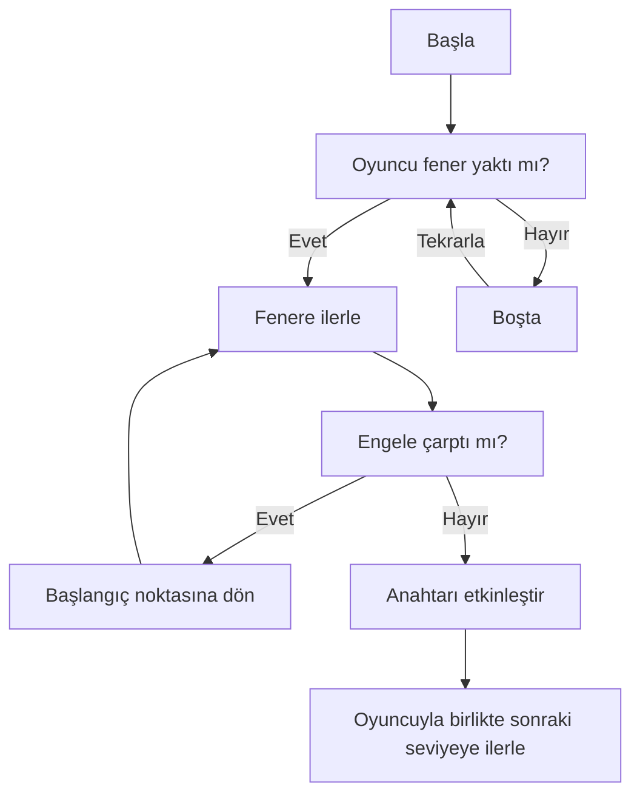

# Yazılım Geliştirme Laboratuvarı I Proje I

## Otonom Kahraman Davranışı

## Hata Yönetimi Stratejisi
LLM sohbet ekranı, sunucuya erişememesi durumunda hata mesajını kullanıcıya sohbet mesajı şeklinde bildirir. Yerel LLM istekleri `UnityWebRequest` sınıfı üzerinden gönderilmektedir ve varsa hata mesajları bu sınıf üzerinden elde edilmektedir, hatalar oyunun çalışma durumuna etki etmez.

LLM'in gönderdiği mesajlar, sohbet mesajı ve oyun durumuna etki eden mesajlar olarak ikiye ayrılmıştır. Oyun durumuna etki eden mesajlar belirli bir JSON şemasına bağlı olarak iletilmektedir. JSON okumakta `UnityEngine.JsonUtility` sınıfından yararlanılmıştır. `JsonUtility.FromJson` metodu hata verme olasılığına karşı `try catch` blokları içinde yer alır. Burada rastlanan hatalar aynı şekilde sohbet mesajı olarak kullanıcıya iletilir.

## Görseller

